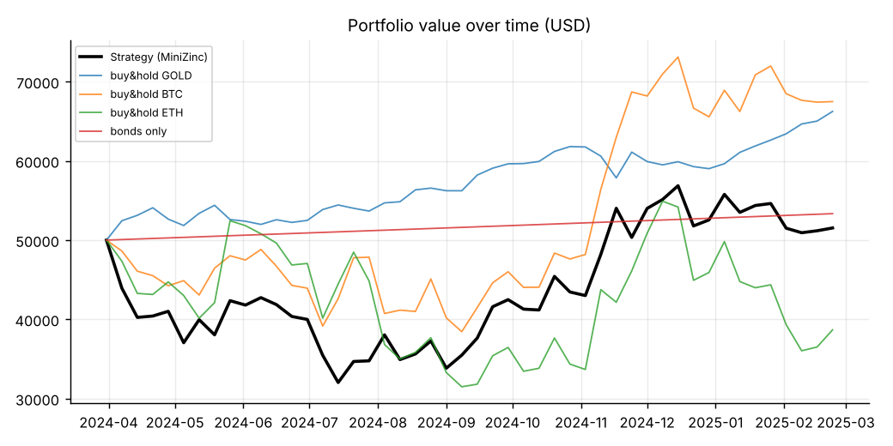

# Financial Portfolio Planning with MiniZinc

**Operations Research Course Project**  
**Institution:** Shiraz University  
**Instructor:** Dr. Ziarati  
**Team Members:** Helia Shames - Neda Zare
---

## 1. Overview

We act as the finance department of a company that invests **$50,000** starting on **1 April 2024**, deciding **once per week**
how to split its capital between three opportunities:

| Opportunity | Rules (from the project statement) |
|---|---|
| **Gold** | tradable only in whole-number percentages of its price |
| **Cryptocurrencies** (BTC, ETH) | any fractional amount; spot trading and margin trading (long/short, leverage 1–3, must be closed within one month, optional TP/SL) |
| **Government bonds** | fixed 0.55 % per month, capital locked for one month, fractional amounts allowed |

Both the **forecasting** (linear regression) and the **decision making** (portfolio optimisation) are formulated in
**MiniZinc**. Python is only the glue: it prepares the data, writes the `.dzn` data files, calls MiniZinc, and simulates the market.

## 2. Method

Every simulated week runs the same loop:

```
 weekly closes ──► features (own last 2 returns + one related asset)
                        │
                        ▼
   regression_ols.mzn  ──►  forecast of next week's return for gold, BTC, ETH
                        │
                        ▼
   portfolio.mzn (MILP) ──►  gold lots, spot $, new margin position, keep/close, bonds
                        │
                        ▼
   simulator.py: execute trades ─► replay the week day by day (TP / SL) ─► new wealth
```

### 2.1 Forecasting – `models/regression_ols.mzn`

Least-squares linear regression of the next-week return (in %) on an intercept and three features, retrained every
week on a rolling window of the previous 104 weeks (only weeks whose outcome is already known → **no look-ahead**).

The least-squares optimum is characterised by the normal equations, which are *linear* in the coefficients, so they are
stated directly as constraints and solved by the MIP/LP solver:

$$\left(X^\top X\right) w = X^\top y$$

| Asset | Features (known at the start of the week) |
|---|---|
| Gold | own return lag 1, lag 2, BTC return lag 1 |
| BTC | own return lag 1, lag 2, ETH return lag 1 |
| ETH | own return lag 1, lag 2, BTC return lag 1 |

### 2.2 Decision model – `models/portfolio.mzn`

A mixed-integer **linear** program, solved each week with HiGHS.

**Decision variables**

| Variable | Meaning |
|---|---|
| `gold_buy`, `gold_sell` (integer) | number of gold lots (1 lot = 1 % of the gold price) |
| `spot_buy[c]`, `spot_sell[c]` | dollars of BTC / ETH bought or sold on the spot market |
| `y[c,d,l]` (binary), `m[c,d,l]` | open a new margin position on coin *c*, direction *d* (long/short), leverage *l* ∈ {1,2,3}, with collateral `m` — at most one per coin |
| `keep[i]` (binary) | keep an already open margin position for another week (forced to 0 after 4 weeks) |
| `bond_buy` | dollars locked in bonds for 4 weeks |

**Objective** – maximise the expected wealth at the end of the week:

```
cash_after + gold·(1+r_gold) + spot·(1+r_coin) + Σ margin·(1 + leverage·E[position return])
           + kept positions' equity + bonds·(1 + 0.55%/4)
```

The expected position return already includes the effect of take-profit and stop-loss
(the forecast, signed by direction, is capped by TP and floored by SL).

**Constraints**

* cash balance — never spend more cash than available;
* integrality of gold lots and binary choice of (direction, leverage) per coin;
* positions older than 4 weeks must be closed;
* bonds ≤ 50 % of wealth;
* **risk budget** — the stressed loss (stop-loss distance × notional for margin positions, 1.65 × weekly volatility for gold and spot)
  must not exceed 8 % of wealth. Without it, a linear objective would put everything on the single best forecast.

### 2.3 Simulation – `simulator.py`

After the optimiser decides, the week is replayed on **daily closes**: a margin position is closed by a **stop-loss**
(market order at that day's close) or a **take-profit** (limit order at the TP level). TP and SL distances are
1.5 × and 1.0 × the recent weekly volatility (SL capped at 25 %). Bonds pay 0.55 % when their 4 weeks are over.

## 3. Results

Period: 7 April 2024 – 23 February 2025 (**47 weeks**, last complete week in the supplied data). All weekly solves reached optimality; the whole run takes about 30 seconds.

| Strategy | Final wealth | ROI | Max drawdown |
|---|---:|---:|---:|
| **MiniZinc strategy** | **$51,531** | **+3.06 %** | −35.95 % |
| Bonds only | $53,336 | +6.67 % | 0 % |
| Buy & hold gold | $66,240 | +32.48 % | −6.39 % |
| Buy & hold BTC | $67,481 | +34.96 % | −23.12 % |
| Buy & hold ETH | $38,671 | −22.66 % | −39.95 % |

Forecast quality (47 weekly forecasts):

| Asset | MAE of forecast | MAE of "predict 0" | Direction accuracy |
|---|---:|---:|---:|
| Gold | 1.47 % | 1.55 % | 61.7 % |
| BTC | 5.00 % | 4.94 % | 51.1 % |
| ETH | 7.20 % | 7.13 % | 57.4 % |



**Reading the results honestly.** The strategy beats ETH buy-and-hold but trails bonds, gold and BTC over this
particular period. A linear model on three lagged returns has almost no predictive power for weekly returns
(its error is about the same as predicting zero), and the leveraged positions then amplify the noise — which is
also why the drawdown is large. The value of this project lies in the modelling and the end-to-end MiniZinc
pipeline, not in beating the market.

## 4. Repository structure

```
├── models/
│   ├── regression_ols.mzn     # least-squares regression (normal equations)
│   └── portfolio.mzn          # weekly mixed-integer linear decision model
├── data/                      # gold.csv, btc.csv, eth.csv  (daily Close prices)
├── config.py                  # all tunable parameters
├── data_prep.py               # loading, weekly resampling, features
├── forecasting.py             # walk-forward regression via MiniZinc
├── simulator.py               # trading rules, margin positions, TP/SL, bonds
├── mzn_utils.py               # Python ⇄ MiniZinc bridge (writes .dzn, runs the solver)
├── run_simulation.py          # main entry point
├── plots.py                   # figures
└── results/                   # generated outputs (see section 6)
```


## 5. Outputs (`results/`)

| File | Content |
|---|---|
| `weekly_log.csv` | wealth, allocation, forecasts vs actual returns and the decisions of every week |
| `trades.csv` | every trade (gold, spot, margin open/close, bonds) |
| `performance_summary.csv` | strategy vs benchmarks |
| `forecast_quality.csv` | forecast error and direction accuracy |
| `fig_wealth.png`, `fig_allocation.png`, `fig_forecasts.png` | charts |
| `dzn/` | MiniZinc data files of the first simulated week |

## 6. Assumptions and limitations

* "Whole-number percentages of its price" is implemented as lots of 1 % of the gold price.
* "One month" is 4 weeks, for both bonds and margin positions.
* No trading fees, margin interest or liquidation are modelled (kept simple); the stop-loss keeps losses below the collateral.
* TP/SL are checked on daily closes, not intraday highs and lows; a triggered TP/SL closes the whole position.
* Gold has no weekend prices; its Friday close is carried forward.
* The optimiser looks only one week ahead, so bonds (which lock capital for 4 weeks) are chosen myopically.
* Only price data was supplied, so no global financial indicators are used as regressors for gold.

